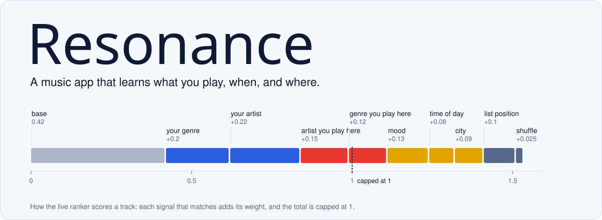
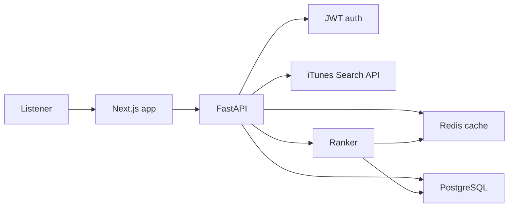

<picture>
  <source media="(prefers-color-scheme: dark)" srcset="docs/readme/banner-dark.svg">
  
</picture>

Resonance is a music app with a home screen that rebuilds itself around you. It plays real 30-second previews from the iTunes catalogue. Every play, like and skip is logged, and the next refresh leans towards what you actually listen to, at that time of day, and at that spot. If you always play the same artist at the gym, they come back when you're at the gym.

## What's in it

- **A home screen of shelves:** Recommended for you, Based on your mood, Morning/Afternoon/Evening picks, Because you like these artists, Hidden gems, Discover weekly and workout mixes. Each shelf says why it's there.
- **Here with you:** a shelf that only appears where you've listened before. Plays are bucketed by geohash into roughly 200 m squares, so your favourite café gets its own mix.
- **Search, a player with a queue, favourites, playlists you can share with friends,** and a friends' activity feed.
- **An admin page** with listening analytics.

## How a track gets ranked

For each shelf, the API turns your history, mood, the time of day and your city into search queries, and pulls candidates from iTunes. Redis caches those lookups. Each candidate then gets a score: a base of 0.42, plus a fixed weight for every signal it matches. Those signals are your genres and artists, the artists and genres you play at this spot, your mood, the time of day and your city. A small bonus goes to higher search positions, and a little jitter keeps refreshes from repeating. The total is capped at 1, which is the picture above. Weights live in `services/api/app/recommender/engine.py`.

The live ranker is deliberately simple, so a shelf comes back fast. `recommender/training.py` holds the offline pipeline meant to replace it once there's enough listening data: TF-IDF content similarity, SVD collaborative filtering and an XGBoost pairwise ranker. It isn't wired into the API yet.



## Run it

With Docker:

```powershell
Copy-Item .env.example .env
docker compose up --build
```

The app is on http://localhost:3000 and the API docs are on http://localhost:8000/docs. Postgres runs the migrations in `services/api/migrations` on first start.

Without Docker, start Postgres and Redis yourself, point `.env` at them, then:

```powershell
cd services/api
python -m venv .venv; .\.venv\Scripts\Activate.ps1
pip install -r requirements.txt
uvicorn app.main:app --reload --port 8000
```

```powershell
cd apps/web
npm install
npm run dev
```

## Where things are

| Path | What's there |
|---|---|
| `apps/web` | Next.js 15 app: pages, player, shelves |
| `services/api/app/api/routes` | Auth, music, playlists, recommendations, social, location and admin endpoints |
| `services/api/app/recommender` | The live ranker and the offline training pipeline |
| `services/api/migrations` | The Postgres schema |
| `docs/` | Architecture notes and deployment |

Built with Next.js, TypeScript, Tailwind, FastAPI, SQLAlchemy, PostgreSQL, Redis and Docker.
